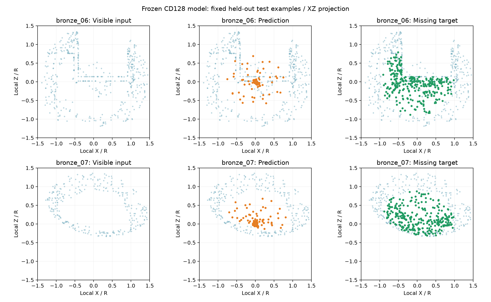
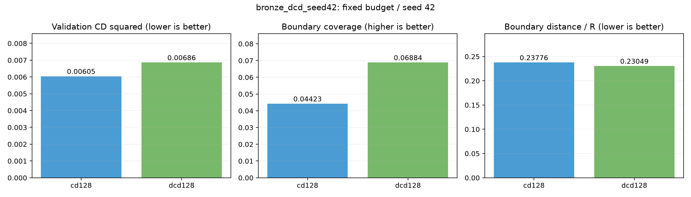
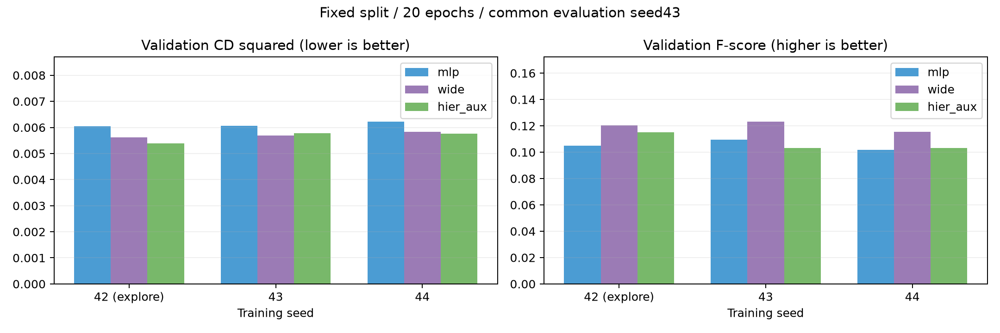
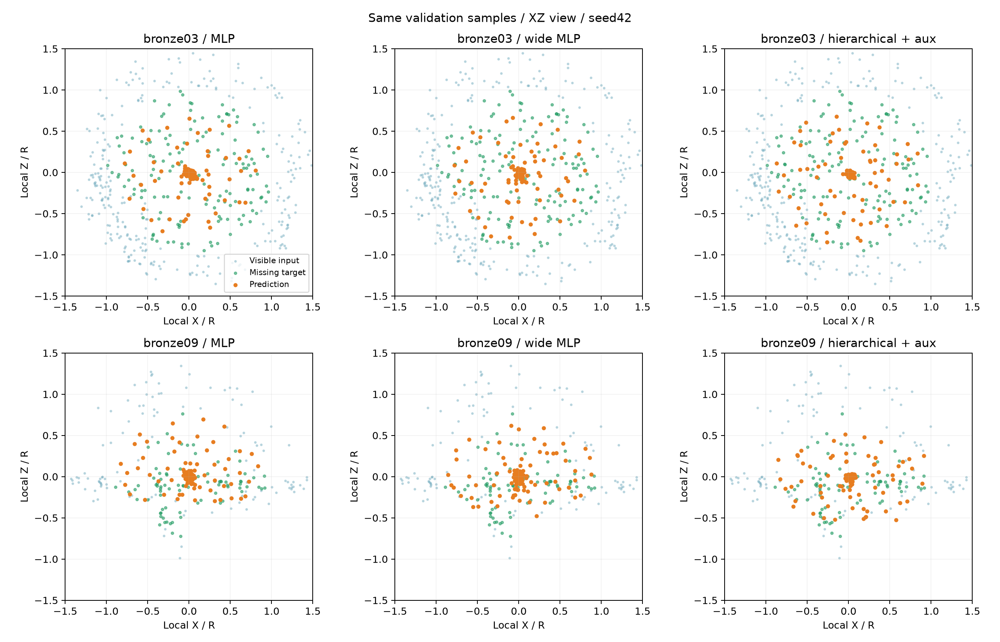
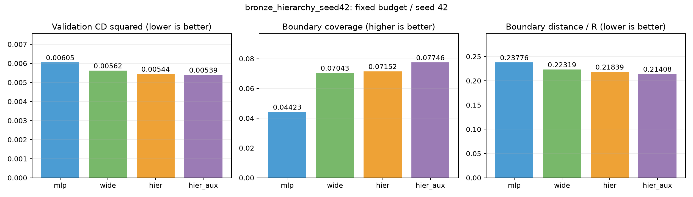

# 2026-10-13 青铜器局部补全实验记录

已跑通点云补全原型：OBJ表面采样、球形缺口构建、训练、验证选型、独立测试、残缺PLY推理与结果预览。当前不含文本条件模型、交互选区界面或网格重建。

## 数据与实验范围

14个器物，每器物20个模拟球形缺口，共280样本。训练/验证/测试按器物划分10/2/2，对应200/40/40个缺口。完整样本4096点，模型输入512点、输出128点。归一化仅依据可见输入。源模型是网格采样，实验不能代表真实损伤修复能力。

原型按验证CD²冻结CD128模型后，独立测试40个缺口：CD²=0.005952左右，F-score=0.115449（阈值0.02）。[完整测试指标](metrics/prototype_test.json) · [选择记录](metrics/prototype_selection.json)



上图用于测试结果章节：两个测试器物各首个固定缺口，蓝色可见输入、橙色预测、绿色缺失目标；统一XZ投影与局部半径尺度，非随机代表样本。预测仍存在聚集与表面偏移。

## 文献依据的损失实验

参考Wu等NeurIPS2021的DCD，使用等点数目标128，与CD128同预算对照；训练alpha50、计数指数0.5，不沿用CD损失的R²缩放。仅借鉴损失，非完整论文复现。

| 验证指标 | CD128 | DCD128 |
|---|---:|---:|
| CD² ↓ | 0.00604554 | 0.00686245 |
| F-score ↑ | 0.105107 | 0.117269 |
| 等点数DCD ↓ | 0.931298 | 0.894745 |
| 点到源网格距离/R ↓ | 0.072809 | 0.115288 |

DCD缓解聚集，但整体CD²和离面误差变差，未替换基线。[作者论文](https://arxiv.org/html/2111.12702v1) · [对照指标](metrics/dcd_comparison.json)



此图用于消融章节，比较验证CD²、模拟球形外缘覆盖率和外缘距离；“外缘”不是网格棱边或真实缺口接缝。

## 分层解码与容量对照

借鉴PF-Net父点+残差子点和多阶段监督，保留原编码器，采用32父点→128子点。粗层目标通过训练真值FPS取得。0.01粗层监督参考作者早期权重，但分辨率、层数和输出约束均有改造；不含原论文多尺度编码器、三级解码或对抗模块，不是完整PF-Net复现。

为区分结构与容量收益，增加参数相近的宽MLP：614,852参数；分层模型615,084参数，相差约0.038%。各组20轮、CPU、batch8、学习率0.001、训练目标128点。

seed42探索结构和粗监督权重后固定方案，以seed43/44复验；汇总评价输入采样统一seed43。最佳轮次仍按各训练过程验证CD²选择。只使用验证集，未再次用已评价的原型测试集选型。

| 三训练种子平均验证指标 | 小MLP | 宽MLP | 分层+粗监督 |
|---|---:|---:|---:|
| CD² ↓ | 0.00610990 | 0.00571625 | 0.00564275 |
| F-score ↑ | 0.105478 | 0.119630 | 0.107170 |

只看新增种子43/44：宽MLP平均CD²=0.00576445，分层=0.00576711，几乎一致；F-score分别0.119284与0.103180。分层相对宽MLP的优势没有稳定复现，不能仅用seed42的4.02%提升宣传结构收益。

seed42质量诊断中，分层近邻距小于0.02R的点比例为45.86%，宽MLP为28.40%；分层的点到网格距离/R也略差。这是需要解决的负面表现。聚集统计是工程诊断，不是论文标准指标；目标网格只用于评价，未用于推理投影。



用于复验章节，展示统一评价采样下三个种子的CD²与F-score。seed42是探索种子，43/44是确认种子。训练随机种子复验没有增加验证器物的多样性，标准差不是置信区间。



用于结果分析章节：两个验证器物各首个固定缺口，三列小MLP、宽MLP、分层+监督，统一XZ视图，蓝色上下文、绿色目标、橙色预测。



用于方法消融章节：小MLP、宽MLP、分层、分层+粗监督，分别检查容量、结构和辅助监督的影响。

[PF-Net作者生成器](https://github.com/zztianzz/PF-Net-Point-Fractal-Network/blob/master/model_PFNet.py) · [作者训练代码](https://github.com/zztianzz/PF-Net-Point-Fractal-Network/blob/master/Train_PFNet.py) · [复验协议](metrics/hierarchy_protocol.json) · [全部复验指标](metrics/hierarchy_summary.json) · [seed42消融](metrics/hierarchy_seed42_comparison.json)

## 验证与复现

40项代码检查通过，包含损失梯度、坐标和颜色保持、球形范围、数据划分、FPS、分层/宽MLP权重加载及完整轮次续训一致性。

```powershell
.\.venv\Scripts\python.exe -m unittest discover -s tests -v
```

分层实验命令（需要本地数据集，已有输出目录不会覆盖）：

```powershell
.\.venv\Scripts\python.exe train.py --dataset outputs/datasets/bronze_20261013_seed42 --epochs 20 --device cpu --output-mode tanh --target-points 128 --architecture hierarchical --coarse-points 32 --coarse-weight 0.01 --output-dir outputs/runs/my_hierarchy_run
```

宽MLP对照使用 `--decoder-width 1140`，移除分层选项；小MLP使用默认宽度256。其余配置保持一致。

完整[研究依据与计划](../../../LITERATURE_PLAN.md)。原始模型、点云数据、训练权重和运行输出在本地models/、outputs/，未随Git上传；本目录提供可直接在GitHub查看的报告、图片与JSON证据。JSON中的PROJECT_ROOT为本地项目目录占位符。

原型部署包和旧冻结模型继续保留。当前只是小规模方法研究，验证/测试各2个器物；后续研究需新的独立器物确认，不能反复根据已使用测试集调参。

## 当日后续实验与汇总报告

[带图Word实验日报](2026年10月13日青铜器局部补全实验报告.docx)。

- [PU-Net借鉴排斥项：固定预算对照](reports/bronze_repulsion_confirmation/README.md)
- [邻域几何编码：参数相同的消融](reports/bronze_neighborhood_confirmation/README.md)
- [邻域编码收敛对照：20→40→60轮](reports/bronze_neighborhood_convergence/README.md)
- [器物级四折交叉验证](reports/bronze_object_cv4/README.md)
- [64缺口方案的训练种子配对复验](reports/bronze_quantity_confirmation/README.md)
- [同一缺口五方案对照](reports/matched_cases_seed42/README.md)
- [同一缺口方案对照](reports/neighborhood_cases_seed42/README.md)
- [同一缺口方案对照](reports/neighborhood60_cases_seed42/README.md)
- [基础排查与单器物拟合](reports/basic_fit/README.md)
- [一对一点匹配损失对照](reports/assignment_fit/README.md)
- [固定更新次数的训练缺口数量对照](reports/quantity_fit/README.md)

最新64缺口配对确认：新增seed43/44的同器物新缺口CD²均值下降26.76%，换器物下降15.65%；但聚集增加，seed44同器物F-score下降。评价区域与训练目标存在表面重叠，属于固定开发样本复验，不能称为独立盲测。原型继续冻结。
