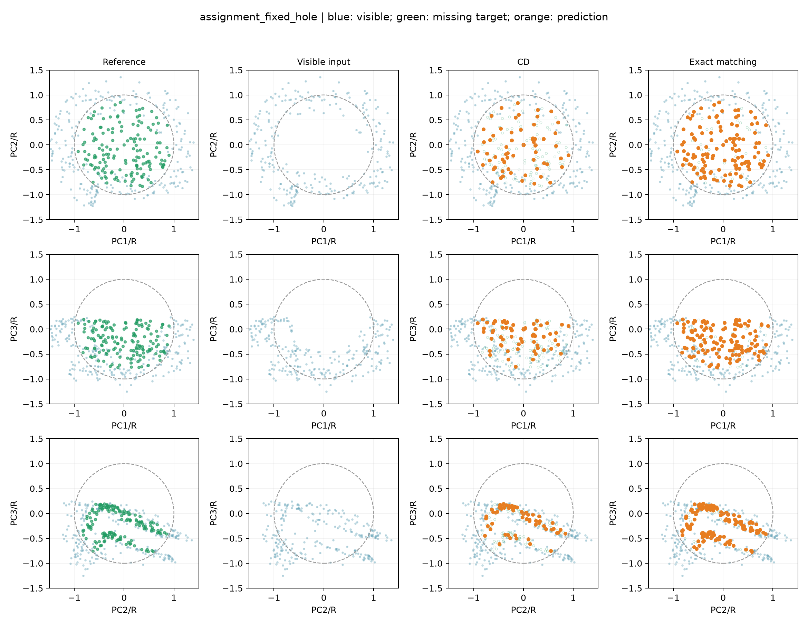
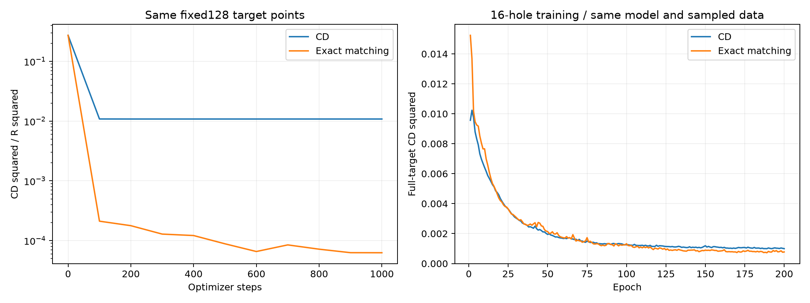
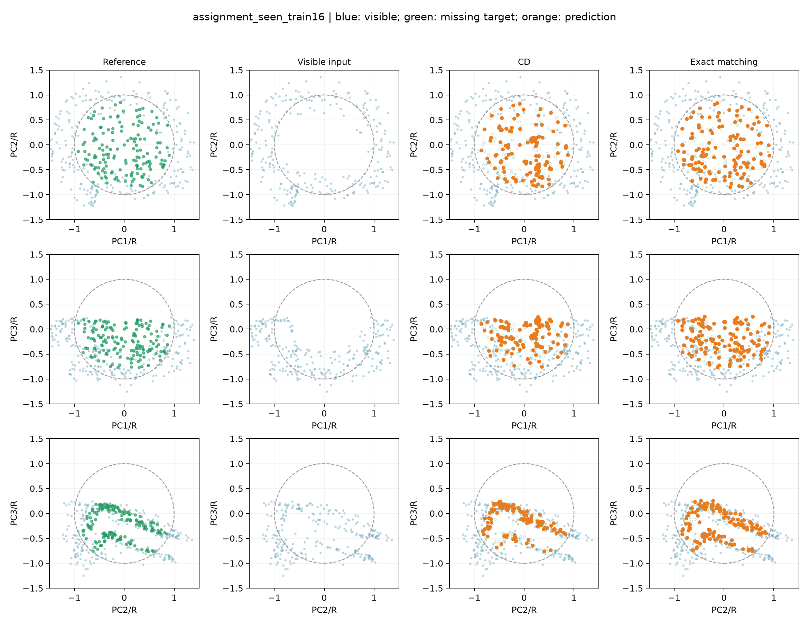
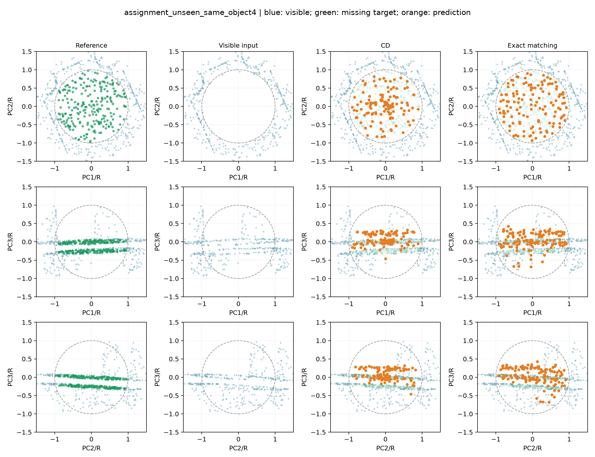
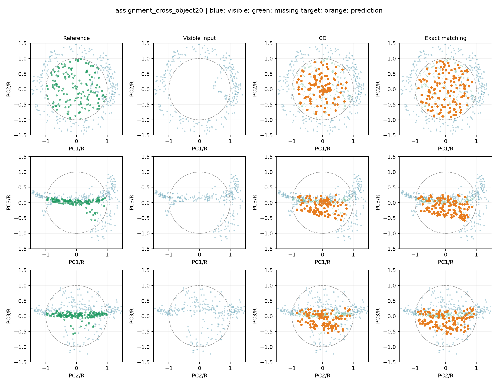

# 一对一点匹配损失对照

## 文献与实现区别

参考[PCN（3DV2018）第4.3节](https://arxiv.org/pdf/1808.00671)与[作者tf_util.py](https://github.com/wentaoyuan/pcn/blob/master/tf_util.py)。原文粗层使用等点数的平均欧氏EMD，作者采用CUDA近似匹配。本实验用[SciPy精确方阵最小代价匹配](https://docs.scipy.org/doc/scipy/reference/generated/scipy.optimize.linear_sum_assignment.html)，算法为修改的Jonker-Volgenant，不是作者近似求解器。

成本为欧氏距离，匹配后求平均并除以缺口半径R，不是平方距离/R²。离散对应不求导，匹配距离对坐标求导。只有128缺失点、原逐点编码/tanh/解码1140，没有PCN多阶段全物体结构和细层CD。本实验是借鉴对照。

CD仍使用本项目双向平方CD/R²。两种损失的原始数值不能直接比较；所有结果用相同完整缺失目标CD²、F-score及几何诊断评价。等轮数不代表等计算成本。

## 固定缺口1000步

复用相同初始化seed42、512输入、固定128目标、Adam lr0.001及1000步；目标顺序不作为匹配约束。

|损失|CD²/R²↓|F-score↑|精确平均匹配距离/R↓|最近对应不同目标位置|
|---|---:|---:|---:|---:|
|CD|0.01083840|0.677714|0.369565|60/128|
|Exact matching|0.00006264|1.000000|0.004974|127/128|

## 本轮判断

固定目标的CD²/R²约降低99.42%，最近目标对应由60/128增至127/128，固定目标F-score为1。训练16缺口的完整目标CD²下降约22.20%，F-score提高到0.718，说明这轮改动改善了拟合与覆盖。

同器物4新缺口的CD²从0.00588787变为0.00606022，F-score从0.140230降至0.121753，到网格距离/R从0.085778升至0.104476。换器物评价也变差，因此本轮不采用该损失，不将固定拟合改善等同于泛化收益。

这个对照同时改变了对应方式、距离形式（平方与欧氏）和半径缩放；不能把全部变化因果归于一对一对应。若要单独归因，还需平方距离匹配等对照。下一步优先排查训练缺口的覆盖范围，在固定优化更新数下比较训练缺口数量，保留CD/逐点基线；这是一项待验证假设，不认定数据量是唯一根因。

## 同器物16缺口200轮

同一司母戊鼎前16缺口训练、后4缺口评价，另一个青铜觥20缺口评价。只改变训练损失：seed42、batch4、lr0.001、输入512/输出与目标128、615236参数均固定，从头训练200轮，取last.pt；不使用新缺口挑选轮数或权重。复用CD基线并校验模型哈希与数据指纹。

|范围|损失|CD²↓|F-score↑|聚集比例↓|网格距离/R↓|
|---|---|---:|---:|---:|---:|
|seen_train16|CD|0.00099552|0.661902|10.40%|0.017563|
|seen_train16|Exact matching|0.00077452|0.717674|0.78%|0.022243|
|unseen_same_object4|CD|0.00588787|0.140230|5.66%|0.085778|
|unseen_same_object4|Exact matching|0.00606022|0.121753|0.00%|0.104476|
|cross_object20|CD|0.00831449|0.116481|1.41%|0.147531|
|cross_object20|Exact matching|0.01024431|0.083430|0.31%|0.197994|

聚集为最近预测点距离<0.02R的比例，是工程诊断。网格仅用于评价，不用于预测投影或训练。目标点少于128时原采样会重复，因此一对一点索引不保证目标坐标都不同。

### seen_train16
样本：`train/model_0002_sample_0000`；两方法相同采样与PCA视角，真值PCA仅用于展示。

### unseen_same_object4
样本：`train/model_0002_sample_0016`；两方法相同采样与PCA视角，真值PCA仅用于展示。

### cross_object20
样本：`val/model_0003_sample_0000`；两方法相同采样与PCA视角，真值PCA仅用于展示。

## 限制

只用一个器物与一个训练种子；同器物新缺口只有4个，换器物只评价一个器物。本轮不能声称稳定青铜器泛化收益，原型保持冻结。固定缺口拟合的改善也不能直接转述成新缺口补全改善。
