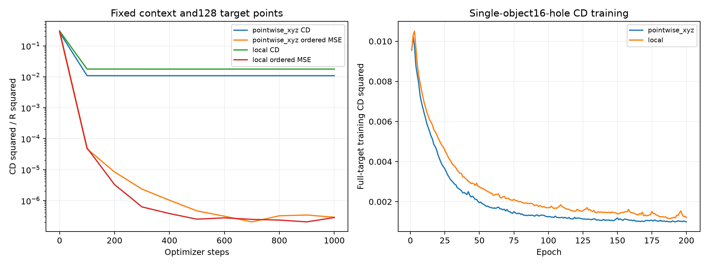
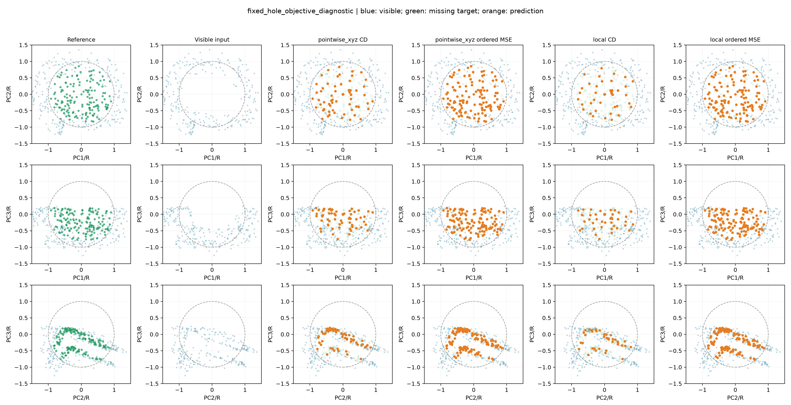
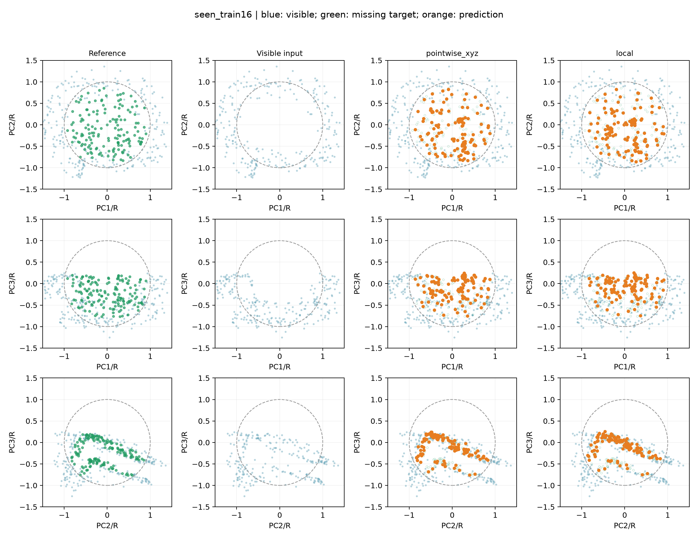
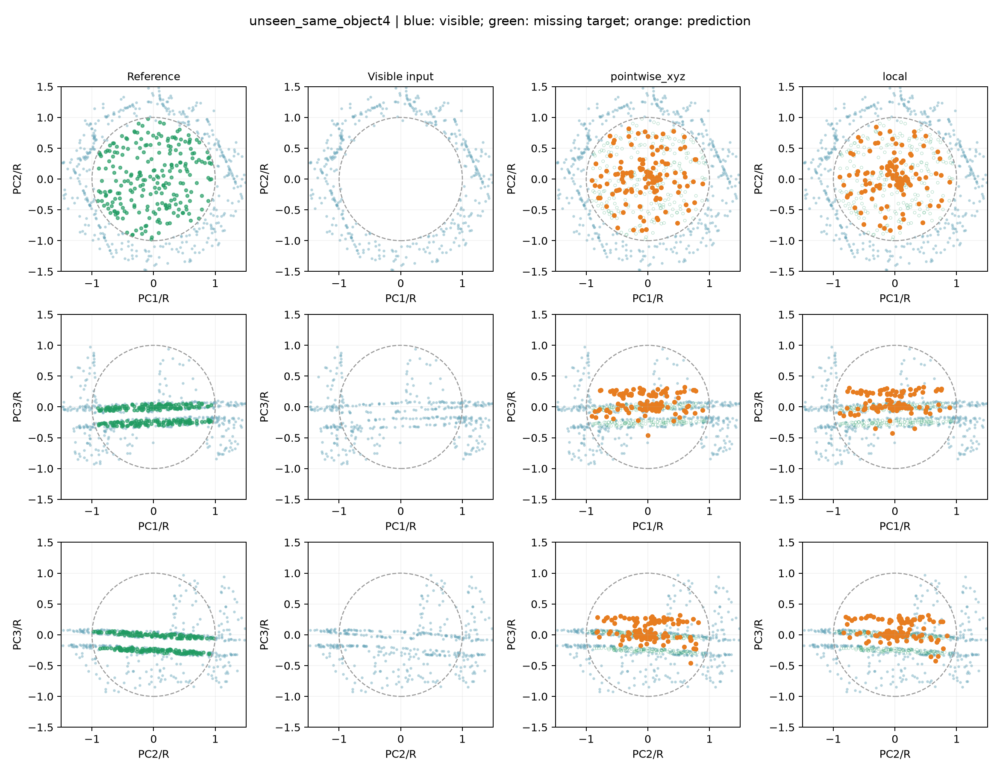
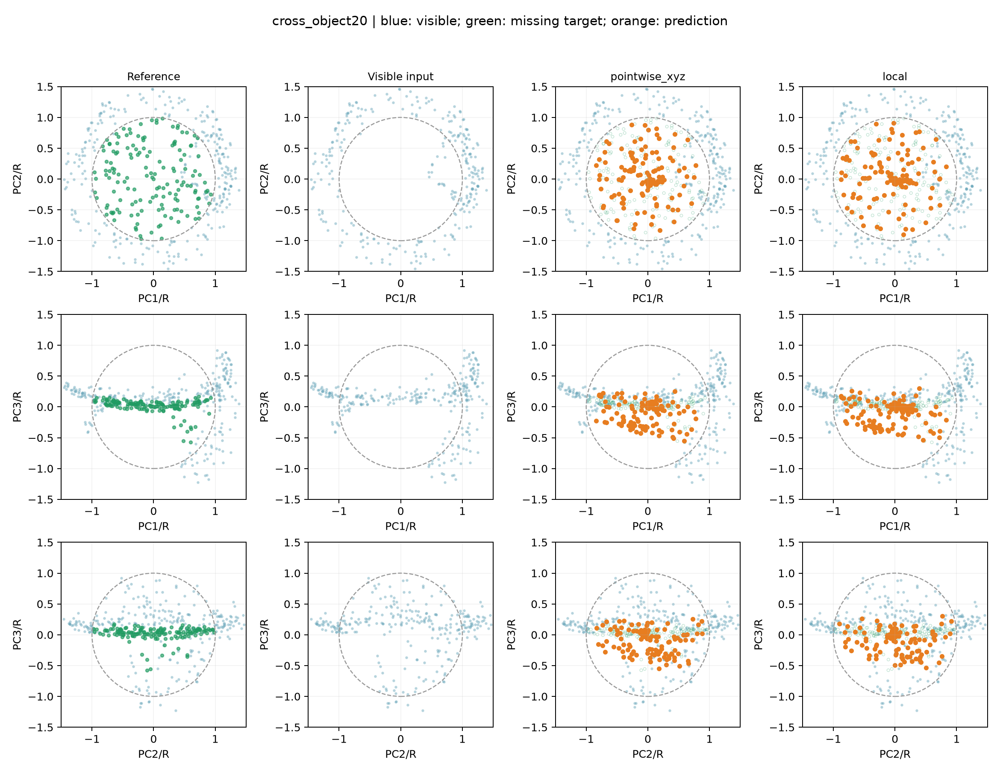

# 基础排查与单器物拟合

依据[Stanford CS231n的tiny-subset sanity check](https://cs231n.github.io/neural-networks-3/#sanity-checks)先检查小样本能否拟合。本轮属于工程诊断，不是新补全方法；小样本能拟合也不能证明整条实现和泛化都正确。

## 数据检查

原训练/验证12器物的240个样本：240/240通过有限数、完整/可见/缺失分区、球形掩码、可见输入归一化和同器物坐标恢复检查。原两个测试器物未读取。
目标点数85–813，其中19个缺口少于128点，训练会有放回采样；输入抽样重复比例均值3.45%。
FPS32中心位于缺口周围2R内的比例均值29.69%，每组16近邻的平均不同坐标数15.74。这些是采样诊断，不证明失败原因。
不同OBJ没有统一语义朝向；同器物各缺口没有坐标翻转。PCA轴不等同于器物朝向，因此本检查不能认定跨器物朝向已经合适，仍需单独旋转/对齐对照。

## 固定缺口检查

司母戊鼎第一个缺口：固定512输入和128目标点、seed42、Adam lr0.001、1000次更新，两个模型参数均615236。CD出现平台后追加同配置有序坐标MSE诊断。目标顺序固定，MSE结果不作为真实无序补全方案，也不参与16缺口训练。

|模型|诊断损失|最终固定目标CD²/R²↓|完整缺失目标CD²↓|
|---|---|---:|---:|
|pointwise_xyz|CD|0.01083840|0.00121520|
|pointwise_xyz|ordered MSE|0.00000029|0.00030673|
|local|CD|0.01771627|0.00176704|
|local|ordered MSE|0.00000028|0.00030674|

## 本轮判断

数据基本不变量未发现错误，但这不等于全部实现已被证明正确。同一固定缺口的CD优化停在0.01084/0.01772的CD²/R²；改用有序坐标诊断后，同结构可降至约2.9×10⁻⁷，固定目标F-score为1。说明两模型至少具备记住这组点的表达和优化能力，不能把问题仅归结为网络太小。

最近目标对应检查：CD训练的128个预测点分别只匹配到60/39个不同目标位置，而有序诊断对应128/128。结合CD平台，这支持进一步排查最近邻匹配和点覆盖问题；仅凭一个缺口不能认定它是全部泛化问题的根因。详见matching_diagnostic.json。

单器物16缺口的训练F-score可达0.662/0.581，但同器物4个未训练缺口降至0.140/0.139，存在明显记忆与新缺口迁移差距。后4缺口的类型和大小也可能影响结果，因此不把差距完全归因为器物数量不足。

下一步建议先做有文献依据的一对一点匹配损失对照，保留逐点编码、等点数和固定预算，再检查同器物新缺口是否改善。有序MSE只用作诊断，不能直接替换无序点集训练。DCD之前已经验证未改善几何，不以这次诊断倒推它有效。

文献依据：[PCN（3DV2018）第4.3节](https://arxiv.org/pdf/1808.00671)比较CD与EMD，EMD使用等点数的双射对应；[作者pcn_emd.py](https://github.com/wentaoyuan/pcn/blob/master/models/pcn_emd.py)对粗点云使用EMD、细点云使用CD。本项目128点局部补全的一对一损失对照属于借鉴改造，不是完整PCN复现，也尚未得到青铜器收益证据。

## 单器物多个缺口

仅用司母戊鼎前16个缺口训练200轮、batch4、CD/R²，后4个新缺口与商代青铜觥20缺口只用于末轮评价。训练清单只有一个真实器物ID且全部标train，未伪造器物ID或放宽原器物划分防护。模型从头训练，未用固定缺口诊断权重暖启动。

|评价范围|模型|样本数|CD²↓|F-score↑|真实目标FPS128采样参考CD²|
|---|---|---:|---:|---:|---:|
|seen_train16|pointwise_xyz|16|0.00099552|0.661902|0.00029980|
|seen_train16|local|16|0.00121039|0.581148|0.00029980|
|unseen_same_object4|pointwise_xyz|4|0.00588787|0.140230|0.00047482|
|unseen_same_object4|local|4|0.00596942|0.139422|0.00047482|
|cross_object20|pointwise_xyz|20|0.00831449|0.116481|0.00037215|
|cross_object20|local|20|0.01010063|0.102759|0.00037215|

FPS128与随机128采样参考直接使用真值，仅帮助解释输出点数和采样误差，不能称为理论下界或实际模型。目标不足128时覆盖全部真实点后补重复点。跨器物只评价一个器物，结果不可推广；后4个新缺口也不是独立新器物。

### seen_train16
样本：`train/model_0002_sample_0000`。用途：区分训练记忆、同器物新缺口与换器物的形状恢复。

### unseen_same_object4
样本：`train/model_0002_sample_0016`。用途：区分训练记忆、同器物新缺口与换器物的形状恢复。

### cross_object20
样本：`val/model_0003_sample_0000`。用途：区分训练记忆、同器物新缺口与换器物的形状恢复。

