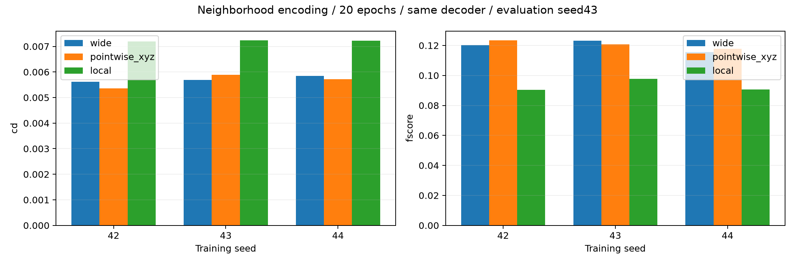

# 邻域几何编码：参数相同的消融

## 文献与改造范围

[PointNet++论文第3.2节](https://proceedings.neurips.cc/paper_files/paper/2017/file/d8bf84be3800d12f74d8b05e9b89836f-Paper.pdf)与[作者sample_and_group / pointnet_sa_module](https://github.com/charlesq34/pointnet2/blob/master/utils/pointnet_util.py)是邻域分组与局部池化的依据。原任务是分类/分割；本实验是局部补全改造，不是完整PointNet++复现。

local：可见输入512点→FPS32中心→每中心16个kNN（包含中心）→相对中心坐标3→64→128 MLP→邻域max→拼接中心在缺口坐标中的XYZ→131→128 MLP→全局max；解码器沿用132→1140→384。

pointwise_xyz：输入每点绝对缺口坐标3→64→128，拼接该点XYZ→131→128→全局max；与local完全同参数615236、同解码器及同种子初始权重。它用于容量对照。既有wide为614852参数，差384。

工程选择：单尺度32/16、kNN、无BN/MSG/特征传播、最近球心点启动的确定性FPS、半径坐标、球内tanh与CD/R²。这些固定预算选择不是原论文最佳超参数。kNN局部物理尺度会随密度变化，不能称为固定半径邻域。

三种子42/43/44，各20轮，Adam lr0.001，batch8；数据与输入采样和损失固定，无排斥/边缘项。每运行以验证CD²选择best，最终统一evaluation seed43。协议在训练前保存，未根据结果搜索邻域数。

## 全验证集结果

|种子|方案|最佳轮|CD²↓|F-score↑|
|---|---|---:|---:|---:|
|42|wide|20|0.00561986|0.120323|
|42|pointwise_xyz|20|0.00536549|0.123447|
|42|local|20|0.00719134|0.090456|
|43|wide|20|0.00568856|0.123104|
|43|pointwise_xyz|19|0.00589397|0.120637|
|43|local|19|0.00723921|0.097707|
|44|wide|18|0.00584034|0.115464|
|44|pointwise_xyz|20|0.00571311|0.117716|
|44|local|18|0.00721978|0.090599|

|方案|CD²均值±标准差|F-score均值±标准差|
|---|---:|---:|
|wide|0.00571625 ± 0.00011282|0.119630 ± 0.003867|
|pointwise_xyz|0.00565752 ± 0.00026859|0.120600 ± 0.002866|
|local|0.00721678 ± 0.00002408|0.092921 ± 0.004145|

local相对同参数pointwise_xyz的平均CD²降低：-27.56%（负值表示变差）。每个种子的配对结果见summary.json，标准差不表示器物级置信区间。

## seed42全40缺口的补充诊断

本轮结论：local平均CD²比同参数逐点对照高27.56%，三个种子均变差，F-score也下降。seed42聚集比例与离面距离均更差，因此当前轻量邻域改造未获得支持，不替换原型。这个负结果不否定完整PointNet++，也不能证明局部几何没有价值。

当前local训练误差也高于逐点对照，可能涉及信息汇总方式或训练预算；尚未分离这些原因。下一步如做收敛对照，应同步延长两个方案预算，不针对单个方案选择性续训来宣称结构收益。

|方案|DCD↓|聚集比例↓|网格距离/R↓|
|---|---:|---:|---:|
|wide|0.917684|28.40%|0.071411|
|pointwise_xyz|0.915233|25.35%|0.069732|
|local|0.938758|42.68%|0.077847|

网格仅用于评价，未用于训练、选取邻域或预测投影。聚集比例阈值0.02R是工程诊断。补充诊断只覆盖seed42，不能推广为三个种子的密度/离面结论。

[同缺口三方案图与逐案例指标](../neighborhood_cases_seed42/README.md)

目前只有两个验证器物，而且验证集已参与多轮方法探索；三训练种子不能补足器物数量，已见过的测试集也不能再作为全新盲测证据。已交付原型保持冻结。
