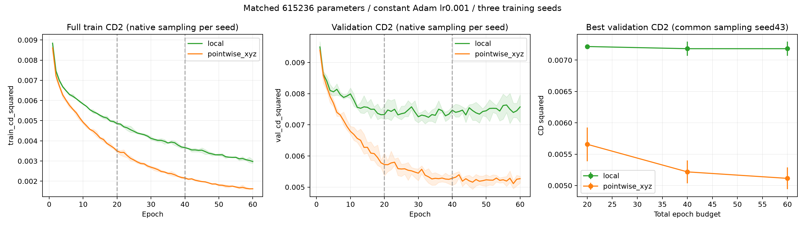

# 邻域编码收敛对照：20→40→60轮

两个方案、三个种子42/43/44同步增加预算，数据、学习率、损失、解码器、点数和参数量均保持。以20轮last.pt恢复优化器和随机状态，新运行目录保留40轮快照；原20轮检查点哈希和历史前缀检查通过。不是新文献方法，而是检查训练预算影响的工程对照。

60轮及中间40轮为开始前固定预算；没有按表现选择性延长某一方案。每个预算都报告此前验证CD²最优best，以及恰好结束轮last。最终评价采样统一seed43；曲线沿用各种子原训练过程的seed+1采样，图中阴影为三种子最小到最大，不是置信区间。

结构依据和改造范围见[上一轮记录](../bronze_neighborhood_confirmation/README.md)，包括PointNet++作者代码、单尺度FPS32+kNN16、相同参数逐点编码控制。

## 各预算的验证均值

|总轮数|方案|检查点|CD²均值↓|F-score均值↑|
|---|---|---|---:|---:|
|20|local|best|0.00721678|0.092921|
|20|local|last|0.00734072|0.092360|
|20|pointwise_xyz|best|0.00565752|0.120600|
|20|pointwise_xyz|last|0.00574125|0.119952|
|40|local|best|0.00718219|0.099590|
|40|local|last|0.00757199|0.105422|
|40|pointwise_xyz|best|0.00521770|0.134195|
|40|pointwise_xyz|last|0.00530953|0.135027|
|60|local|best|0.00718219|0.099590|
|60|local|last|0.00764157|0.104606|
|60|pointwise_xyz|best|0.00511415|0.136810|
|60|pointwise_xyz|last|0.00530461|0.132489|

60轮best：邻域方案CD²相对同参数逐点对照变化为+40.44%（正值为误差增加）。

## 结果解释

逐点对照20→60轮的平均best CD²降低约9.60%，邻域方案仅降低约0.48%。邻域三个种子的原验证最优轮次为35/21/32，40→60轮没有更新best。训练CD²持续下降而验证曲线停滞，提示当前数据和编码改造的泛化问题；不能将此前差距简单归因为只训练20轮。这个观察不证明无限预算下的收敛，也不否定完整PointNet++。

暂缓该邻域改造，保留逐点60轮方案为研究候选。下一步优先做器物级划分复验并补充独立器物，而不是继续在同两个验证器物上搜索邻域参数；当前原型保持冻结。

## 每个种子的60轮结果

|种子|方案|best轮次|best验证CD²|last验证CD²|末轮训练CD²（原采样）|
|---|---|---:|---:|---:|---:|
|42|local|35|0.00705617|0.00768210|0.00305998|
|42|pointwise_xyz|46|0.00493113|0.00512888|0.00163542|
|43|local|21|0.00722260|0.00801374|0.00298088|
|43|pointwise_xyz|58|0.00527621|0.00542856|0.00161700|
|44|local|32|0.00726780|0.00722886|0.00288675|
|44|pointwise_xyz|48|0.00513511|0.00535639|0.00161766|

## seed42补充诊断（全40验证缺口）

|预算|方案|DCD↓|聚集比例↓|到网格距离/R↓|
|---|---|---:|---:|---:|
|20|local|0.938758|42.68%|0.077847|
|20|pointwise_xyz|0.915233|25.35%|0.069732|
|60|local|0.933612|32.27%|0.078035|
|60|pointwise_xyz|0.897075|12.23%|0.067408|

网格仅用于评价。聚集阈值为0.02R，离面与聚集仅评价seed42；不能代替三个种子的几何结论。

[60轮同缺口图](../neighborhood60_cases_seed42/README.md)

不能由60轮结果宣称理论或无限预算下收敛；验证只有两个器物，且已多轮探索，结果需要更多独立器物确认。原型仍冻结。完整配置、逐种子/逐器物指标与标准差见summary.json。
