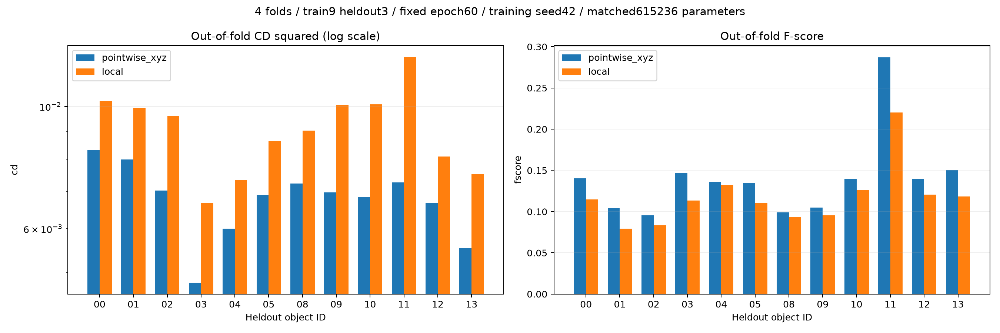
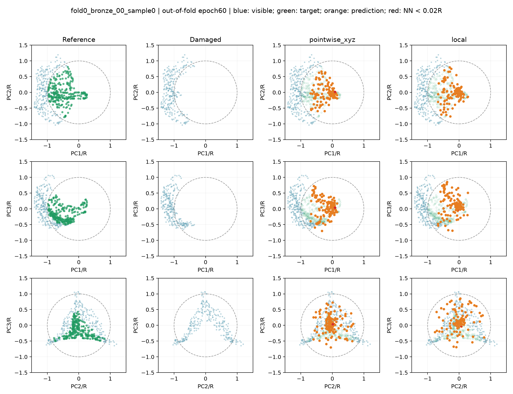
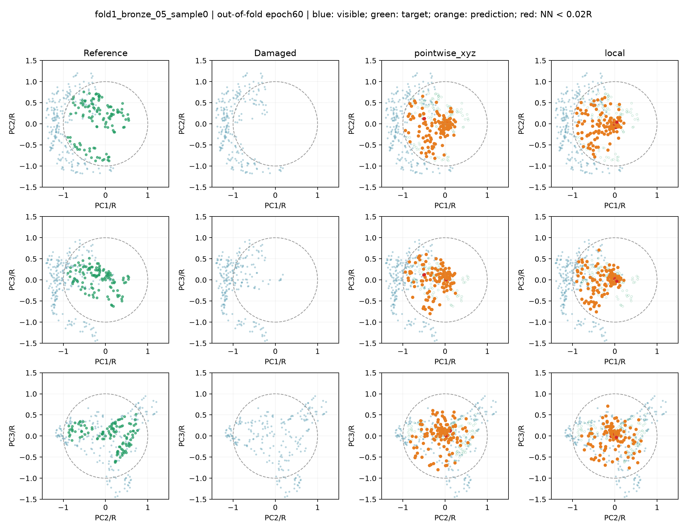
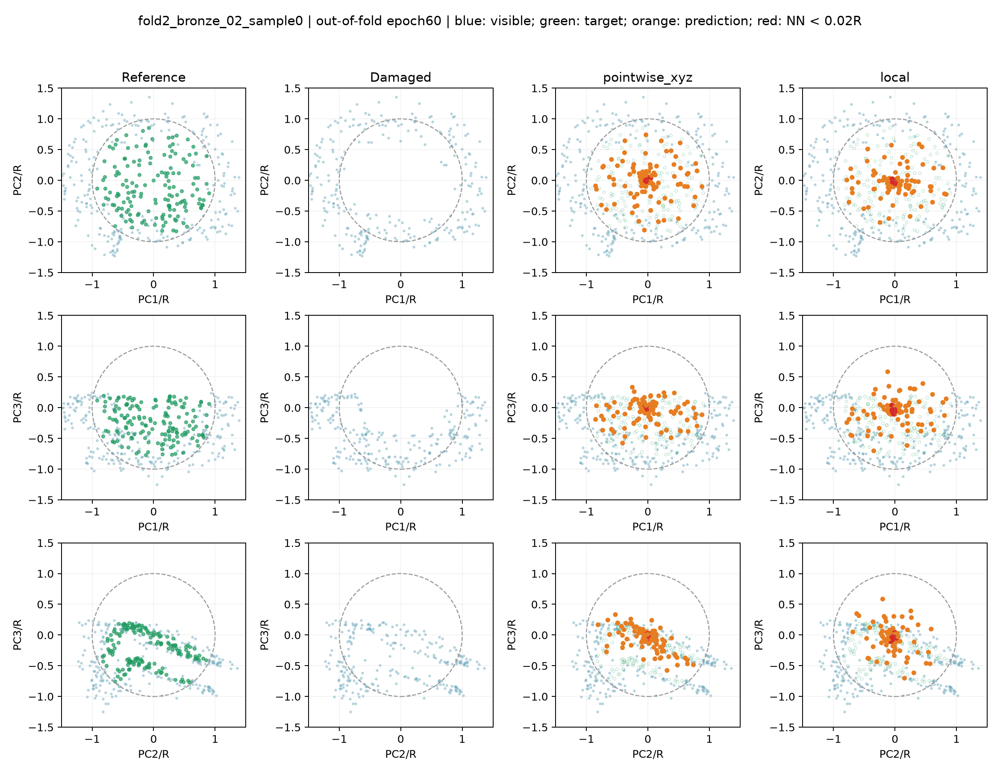
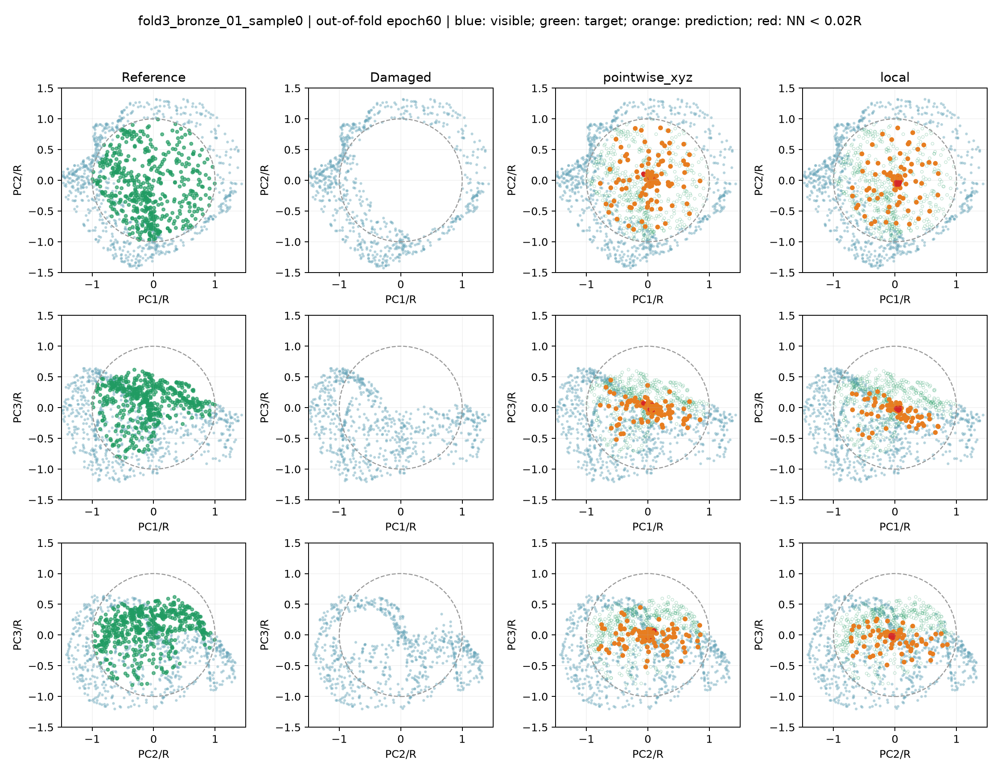

# 器物级四折交叉验证

用原训练/验证12个器物，排除原测试bronze_06与bronze_07。每折9器物180缺口训练、3器物60缺口留出；每个器物恰好一次留出，总计240个折外缺口/方案。原NPZ逐字节复制、哈希校验，不重新挖洞或归一化。

[分组交叉验证原则](https://scikit-learn.org/stable/modules/cross_validation.html#cross-validation-iterators-for-grouped-data)：将器物ID作为组，避免同器物的相关缺口跨训练与留出。这里是固定均衡四折的自定义实现，非调用sklearn。

训练种子固定42、划分种子20261013，两个方法每折均从头训练60轮，无旧模型暖启动；参数均615236，其余配置保持。主结果固定第60轮last.pt，不用留出器物选择best或调整预算。训练代码会保存best.pt，但它不进入主结果。曲线监测不改变学习率或训练规则。

此前三种子检查训练随机性；本轮固定一个种子隔离划分变化，没有进行四折×三种子复验。所有12器物已用于此前开发，故属于探索性复验，不能称为新独立盲测。

## 每折名单

|折|训练器物|留出器物|
|---|---|---|
|0|bronze_01, bronze_02, bronze_03, bronze_04, bronze_05, bronze_09, bronze_10, bronze_11, bronze_13|bronze_00, bronze_08, bronze_12|
|1|bronze_00, bronze_01, bronze_02, bronze_03, bronze_04, bronze_08, bronze_09, bronze_10, bronze_12|bronze_05, bronze_11, bronze_13|
|2|bronze_00, bronze_01, bronze_04, bronze_05, bronze_08, bronze_10, bronze_11, bronze_12, bronze_13|bronze_02, bronze_03, bronze_09|
|3|bronze_00, bronze_02, bronze_03, bronze_05, bronze_08, bronze_09, bronze_11, bronze_12, bronze_13|bronze_01, bronze_04, bronze_10|

## 器物宏平均

|方案|CD²↓|F-score↑|DCD↓|聚集比例↓|网格距离/R↓|
|---|---:|---:|---:|---:|---:|
|pointwise_xyz|0.00680672|0.139844|0.909037|8.71%|0.104358|
|local|0.00913736|0.117300|0.930039|18.37%|0.117687|

邻域local相对逐点对照的宏平均CD²变化：+34.24%（正值为误差更大）。local在0/12个器物上CD²更低，逐器物结果如下。

本轮判断：当前邻域改造在四折与12个器物上均未获得收益，聚集与离面宏平均也更差，因此暂缓这个改造，保留逐点编码作为研究基线。该负结果不否定完整PointNet++，也不构成独立新器物上的盲测结论。交付原型仍冻结。

分组与复制检查通过，全部480条样本诊断数值有限，每种方法的240个原始缺口恰好评价一次，详见audit.json。

|器物|名称|折|逐点CD²|邻域CD²|邻域误差变化|
|---|---|---:|---:|---:|---:|
|bronze_00|何尊|0|0.00834167|0.01023534|+22.70%|
|bronze_01|公元前12-11世纪_权杖顶饰|3|0.00801327|0.00993974|+24.04%|
|bronze_02|司母戊鼎|2|0.00703916|0.00961117|+36.54%|
|bronze_03|商代晚期_青铜觥|2|0.00478675|0.00667581|+39.46%|
|bronze_04|商代晚期_青铜象尊|3|0.00600215|0.00734720|+22.41%|
|bronze_05|商代青铜匜形盖尊|1|0.00690349|0.00866005|+25.44%|
|bronze_08|约公元前575年_升鼎食器|0|0.00724588|0.00904434|+24.82%|
|bronze_09|西周早期_令方彝|2|0.00698714|0.01007909|+44.25%|
|bronze_10|西汉_青铜博山炉|3|0.00685936|0.01009754|+47.21%|
|bronze_11|越王勾践剑|1|0.00728459|0.01231029|+68.99%|
|bronze_12|马踏飞燕|0|0.00668600|0.00811283|+21.34%|
|bronze_13|麒麟像|1|0.00553120|0.00753494|+36.23%|

每器物先平均20个缺口，再对12器物等权平均。DCD固定128目标点抽样5次，alpha1000、指数1；抽样不足时允许重复并记录。聚集阈值0.02R是工程诊断；源OBJ仅用于评价，未用于训练、推理投影或参数选择。

## 固定案例图

每折展示按ID排序的第一个留出器物的第一个缺口，不按误差挑图。蓝为可见、绿为真值、橙为预测、红为近邻小于0.02R的聚集点。真值PCA仅用于显示。

### fold0_bronze_00_sample0
样本：`train/model_0000_sample_0000`。报告位置：器物级泛化复验。

### fold1_bronze_05_sample0
样本：`train/model_0005_sample_0000`。报告位置：器物级泛化复验。

### fold2_bronze_02_sample0
样本：`train/model_0002_sample_0000`。报告位置：器物级泛化复验。

### fold3_bronze_01_sample0
样本：`train/model_0001_sample_0000`。报告位置：器物级泛化复验。

## 解释限制

240个缺口不是240个独立器物；四折训练集有重叠，不能把四折当作完全独立实验来计算显著性。结果只支持已知小规模器物池上的划分敏感性分析。器型差异、分组种子及训练随机性仍需更多独立器物与重复划分核对。原交付模型保持冻结。
