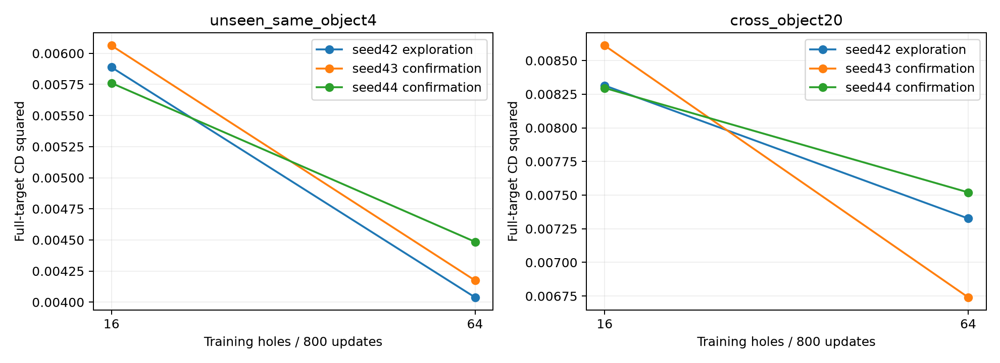
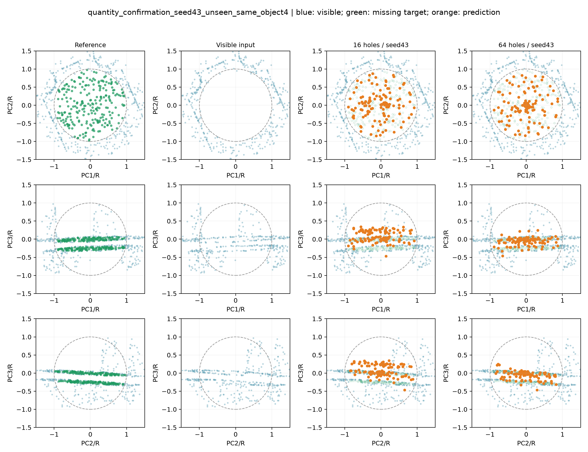
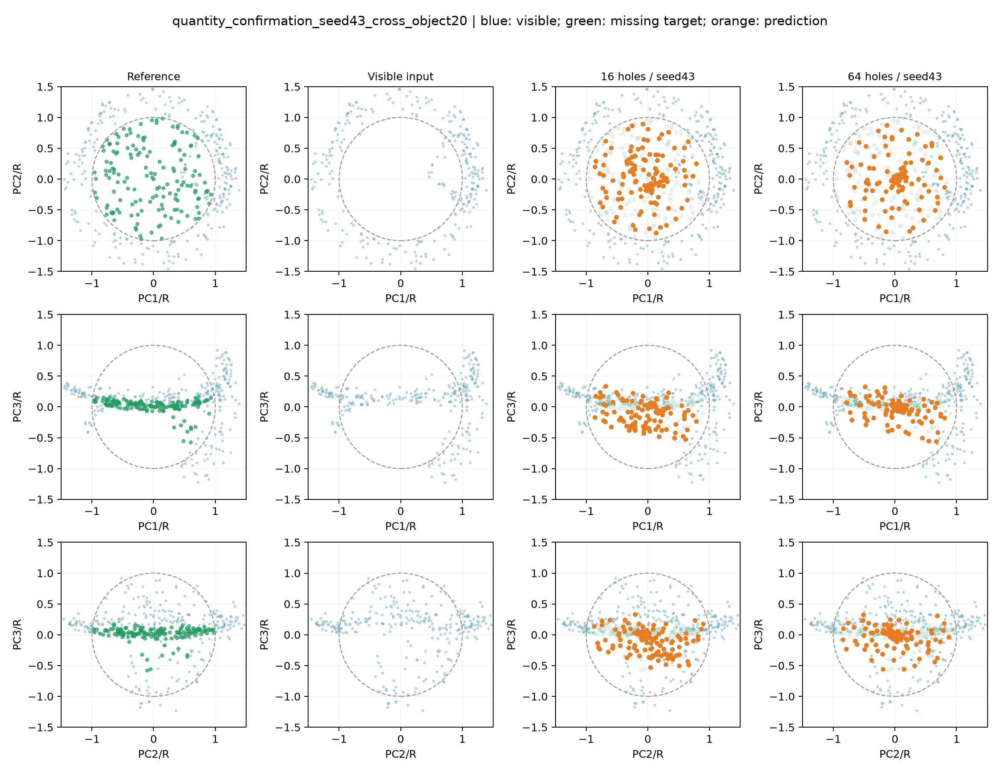
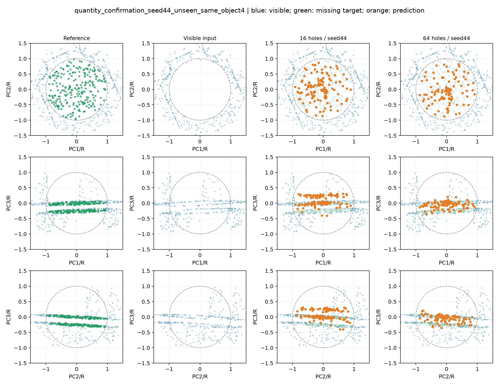
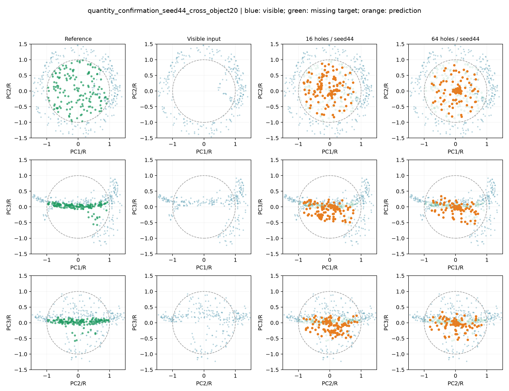

# 64缺口方案的训练种子配对复验

seed42探索后固定64缺口候选，新增训练seed43、44；每种子比较16/64个训练缺口，从头训练，batch4、800次更新，分别200/50轮，取last.pt。网络、学习率、CD²/R²、原数据和生成缺口均固定，评价采样seed43统一。校验数据指纹、模型参数615236、配置及所有Adam参数更新计数。原seed42权重和结果复用。

只改变训练随机种子，未新增器物、缺口生成种子或评价样本。原4个新缺口目标与其他训练目标的表面重叠，换器物仅一个青铜觥。候选来源于已有评价结果，因此这是固定开发样本上的复验，不能称为全新盲测；原测试06/07未使用。

|范围|训练seed|训练缺口|CD²↓|F-score↑|聚集比例↓|网格距离/R↓|
|---|---:|---:|---:|---:|---:|---:|
|seen_train16|42|16|0.00099552|0.661902|10.40%|0.017563|
|seen_train16|42|64|0.00238681|0.331861|20.02%|0.037183|
|seen_train16|43|16|0.00095811|0.661789|8.79%|0.017777|
|seen_train16|43|64|0.00246962|0.303480|15.33%|0.040901|
|seen_train16|44|16|0.00097609|0.662882|14.21%|0.016239|
|seen_train16|44|64|0.00241052|0.323502|20.80%|0.037446|
|unseen_same_object4|42|16|0.00588787|0.140230|5.66%|0.085778|
|unseen_same_object4|42|64|0.00403882|0.163325|19.34%|0.045912|
|unseen_same_object4|43|16|0.00606252|0.133139|2.73%|0.085804|
|unseen_same_object4|43|64|0.00417482|0.162114|16.21%|0.044484|
|unseen_same_object4|44|16|0.00576106|0.129742|5.47%|0.081286|
|unseen_same_object4|44|64|0.00448530|0.110500|20.12%|0.050426|
|cross_object20|42|16|0.00831449|0.116481|1.41%|0.147531|
|cross_object20|42|64|0.00732653|0.125642|18.75%|0.108770|
|cross_object20|43|16|0.00861121|0.109283|1.29%|0.150213|
|cross_object20|43|64|0.00674068|0.134745|16.80%|0.100067|
|cross_object20|44|16|0.00829598|0.114217|1.88%|0.146089|
|cross_object20|44|64|0.00752056|0.130237|21.17%|0.105135|

## 汇总

|统计范围|评价范围|训练缺口|CD²均值 ± 种子总体标准差|F-score均值|聚集均值|网格距离/R均值|
|---|---|---:|---:|---:|---:|---:|
|confirmation_only|seen_train16|16|0.00096710 ± 0.00000899|0.662335|11.50%|0.017008|
|confirmation_only|seen_train16|64|0.00244007 ± 0.00002955|0.313491|18.07%|0.039173|
|confirmation_only|unseen_same_object4|16|0.00591179 ± 0.00015073|0.131441|4.10%|0.083545|
|confirmation_only|unseen_same_object4|64|0.00433006 ± 0.00015524|0.136307|18.16%|0.047455|
|confirmation_only|cross_object20|16|0.00845359 ± 0.00015762|0.111750|1.58%|0.148151|
|confirmation_only|cross_object20|64|0.00713062 ± 0.00038994|0.132491|18.98%|0.102601|
|all_three|seen_train16|16|0.00097657 ± 0.00001527|0.662191|11.13%|0.017193|
|all_three|seen_train16|64|0.00242232 ± 0.00003482|0.319614|18.72%|0.038510|
|all_three|unseen_same_object4|16|0.00590382 ± 0.00012359|0.134370|4.62%|0.084289|
|all_three|unseen_same_object4|64|0.00423298 ± 0.00018686|0.145313|18.55%|0.046940|
|all_three|cross_object20|16|0.00840722 ± 0.00014444|0.113327|1.52%|0.147944|
|all_three|cross_object20|64|0.00719592 ± 0.00033151|0.130208|18.91%|0.104657|

总体标准差仅描述固定评价样本下的训练种子波动；两枚新增种子或三枚总种子不足以证明统计显著性。聚集定义为预测点最近邻距离<0.02R，网格只用于评价。

## 配对变化

- seed42 / unseen_same_object4：CD² -31.40%；F-score差值 +0.023095。
- seed42 / cross_object20：CD² -11.88%；F-score差值 +0.009161。
- seed43 / unseen_same_object4：CD² -31.14%；F-score差值 +0.028975。
- seed43 / cross_object20：CD² -21.72%；F-score差值 +0.025461。
- seed44 / unseen_same_object4：CD² -22.14%；F-score差值 -0.019242。
- seed44 / cross_object20：CD² -9.35%；F-score差值 +0.016020。

## 判断

新增seed43/44均改善同器物新缺口与青铜觥CD²；仅新增种子的同器物CD²均值下降 26.76%，青铜觥下降 15.65%。同器物seed44的F-score下降，因此F-score收益未逐种子成立。同器物聚集均值从 4.10% 增至 18.16%，表面距离改善但薄壁双层和点分布仍不正确。数据覆盖对距离指标的收益可重复，不能声称全面解决补全。

逐种子、指标和几何质量同时判断；CD改善不能替代薄壁结构正确性或点分布质量。增加缺口同时减少每个缺口重复训练，固定更新次数也不等于相同耗时。保留当前冻结原型，复验结果只作为下一轮多器物覆盖实验的依据。

### seed43 / unseen_same_object4
样本：`train/model_0002_sample_0016`；相同上下文与展示视角，PCA只用于绘图。

### seed43 / cross_object20
样本：`val/model_0003_sample_0000`；相同上下文与展示视角，PCA只用于绘图。

### seed44 / unseen_same_object4
样本：`train/model_0002_sample_0016`；相同上下文与展示视角，PCA只用于绘图。

### seed44 / cross_object20
样本：`val/model_0003_sample_0000`；相同上下文与展示视角，PCA只用于绘图。

