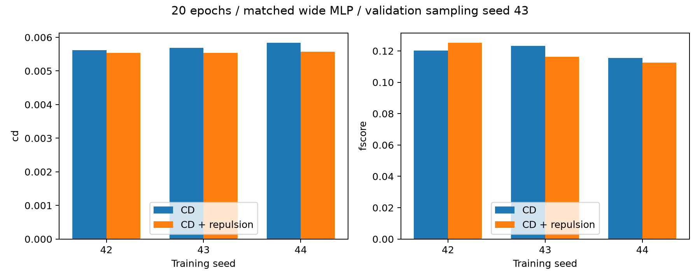

# PU-Net借鉴排斥项：固定预算对照

参考[PU-Net CVPR2018论文](https://openaccess.thecvf.com/content_cvpr_2018/papers/Yu_PU-Net_Point_Cloud_CVPR_2018_paper.pdf)与[作者代码](https://github.com/yulequan/PU-Net/blob/master/code/model_utils.py)。

采用0.07-r×exp(-r²/0.03²)的邻域平均能量，权重0.01。工程改动：距离以缺口半径归一化；以精确4个非自身近邻替代作者球查询20候选后top5去首点及补齐；重建项使用本项目双向平方CD/R²。属于借鉴消融，并非PU-Net完整复现。

复用宽MLP CD基线，参数614852，输入512、输出/目标128，batch8，Adam lr0.001，tanh，20轮，固定数据划分。最佳轮次按各运行验证CD²选取，汇总统一采样seed43；测试集未参与本轮。

|种子|方案|最佳轮|CD²↓|F-score↑|
|---|---|---:|---:|---:|
|42|CD|20|0.00561986|0.120323|
|42|CD + repulsion|20|0.00553829|0.125245|
|43|CD|20|0.00568856|0.123104|
|43|CD + repulsion|19|0.00554038|0.116374|
|44|CD|18|0.00584034|0.115464|
|44|CD + repulsion|20|0.00557015|0.112483|

三种子平均：CD² 0.00571625 → 0.00554961；F-score 0.119630 → 0.118034。
结论：三种子平均CD²降低约2.92%，各种子同方向改善，但F-score均值略降。seed42的近邻聚集比例从28.398%升至29.004%，DCD从0.917684升至0.918043，到网格距离/R从0.071411升至0.071659，均未改善。本轮不能宣称排斥项解决聚集，也不足以替换原型。没有搜索额外权重或带宽。
只有两个验证器物，种子重复不能证明跨器物泛化或统计显著性；聚集与网格距离另见seed42的quality_val.json。已交付原型保持冻结。

