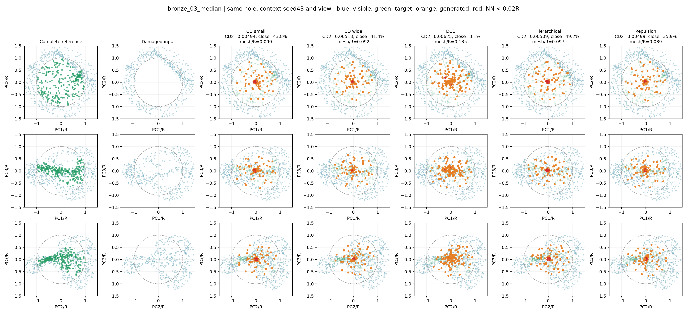
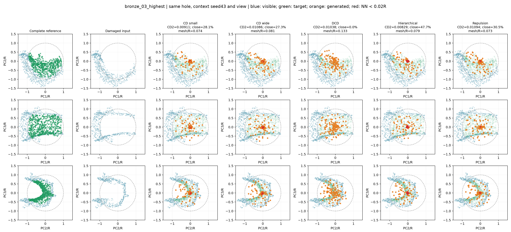
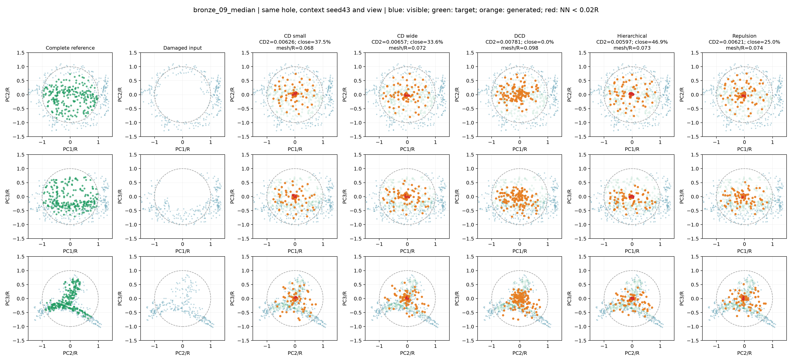
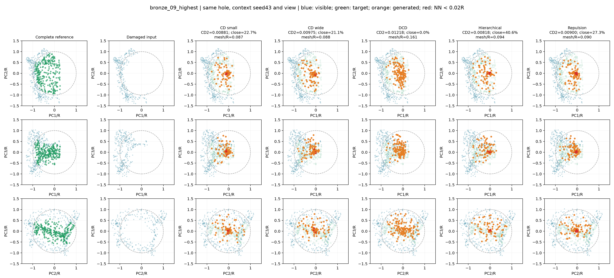

# 同一缺口五方案对照

方案：小MLP CD、宽MLP CD、DCD、分层模型、CD加排斥。另附完整局部参考和残缺输入，共七列、三个投影视角。所有模型seed42，输入抽样统一seed43、每样本索引；同一案例使用完全相同的512点模型输入。可见展示为完整局部上下文，不等于仅512点模型输入。

## 案例选择与图例

每个验证器物按宽MLP CD²排序，选择第11/20及最高误差，共四例；不能把这些图当作随机代表案例。仅使用验证集。每图统一PCA视角、范围±1.5R和点大小。真实目标仅用于评价和展示，未用于预测。

蓝色为可见点，绿色为缺失目标，橙色为预测；红色为具有距离小于0.02R近邻的预测点，并不直接表示离面。虚线圆为球形缺口半径。三视角用于减少单一投影遮挡。

图注建议：同一验证缺口不同补全方案的三视角局部对照。所有方法使用相同输入采样和显示坐标；绿色参考只用于评价。

## 案例指标

|案例|方案|CD²↓|聚集比例↓|网格距离/R↓|球外缘覆盖↑|
|---|---|---:|---:|---:|---:|
|bronze_03_median|CD small|0.004935|43.8%|0.0899|3.8%|
|bronze_03_median|CD wide|0.005176|41.4%|0.0917|5.7%|
|bronze_03_median|DCD|0.006250|3.1%|0.1353|2.8%|
|bronze_03_median|Hierarchical|0.005091|49.2%|0.0969|0.9%|
|bronze_03_median|Repulsion|0.004990|35.9%|0.0891|10.4%|
|bronze_03_highest|CD small|0.009113|28.1%|0.0744|4.8%|
|bronze_03_highest|CD wide|0.010858|27.3%|0.0810|8.4%|
|bronze_03_highest|DCD|0.010377|0.0%|0.1328|2.6%|
|bronze_03_highest|Hierarchical|0.008289|47.7%|0.0785|6.2%|
|bronze_03_highest|Repulsion|0.010939|30.5%|0.0731|6.6%|
|bronze_09_median|CD small|0.006257|37.5%|0.0681|3.5%|
|bronze_09_median|CD wide|0.006571|33.6%|0.0718|2.4%|
|bronze_09_median|DCD|0.007806|0.0%|0.0983|2.4%|
|bronze_09_median|Hierarchical|0.005969|46.9%|0.0728|3.5%|
|bronze_09_median|Repulsion|0.006214|25.0%|0.0743|4.7%|
|bronze_09_highest|CD small|0.008814|22.7%|0.0866|1.8%|
|bronze_09_highest|CD wide|0.009747|21.1%|0.0880|8.8%|
|bronze_09_highest|DCD|0.012176|0.0%|0.1610|4.4%|
|bronze_09_highest|Hierarchical|0.008183|40.6%|0.0937|3.5%|
|bronze_09_highest|Repulsion|0.008998|27.3%|0.0898|7.1%|

### bronze_03_median
样本：`val/model_0003_sample_0005`。报告位置：结果分析—同缺口定性对照。

### bronze_03_highest
样本：`val/model_0003_sample_0015`。报告位置：结果分析—同缺口定性对照。

### bronze_09_median
样本：`val/model_0009_sample_0003`。报告位置：结果分析—同缺口定性对照。

### bronze_09_highest
样本：`val/model_0009_sample_0010`。报告位置：结果分析—同缺口定性对照。

## 如何解读

## 已检查的具体观察

- bronze_03_median：排斥项相对宽CD将聚集比例41.4%降到35.9%，球外缘覆盖5.7%提高到10.4%；三个投影仍可见绿色目标的部分区域没有被橙色点覆盖。
- bronze_03_highest：分层CD²较低（0.008289），但聚集47.7%，高于宽CD的27.3%。DCD聚集为0%，到网格距离/R却从宽CD的0.0810升至0.1328，不能把分散等同于正确表面。
- bronze_09_median：排斥项聚集比例由33.6%降到25.0%，但网格距离/R由0.0718升至0.0743；侧面投影仍存在与绿色参考不一致的形状。
- bronze_09_highest：分层CD²较宽CD低，但聚集由21.1%升至40.6%；DCD到网格距离/R为0.1610，宽CD为0.0880。多个方法对目标外侧区域覆盖不足。

这些是所选四例的观察，不推断为所有青铜器的规律。共同提示是表面形状和覆盖仍未恢复，均匀性改善不足以保证几何正确。下一项候选为保留缺口邻域几何信息的编码器消融，但这些图不能证明全局池化就是误差原因；实施前仍需文献核对和容量对照。

先观察三投影中预测是否覆盖绿色目标，再用网格距离检查离面。红点用于定位局部聚集。球外缘覆盖只是人工球形挖洞的覆盖诊断，不能当作真实破损接缝连续性。不能从二维图或到完整网格距离单独断言接缝已修复。

容量公平的主要对照是宽MLP、分层和排斥；DCD和小CD参数更少。各图并非独立器物重复，也不能取代全40缺口及三训练种子的汇总。原始预测、完整参考、PCA矩阵和实际模型输入保存于同目录NPZ，指标和模型哈希见comparison.json。
