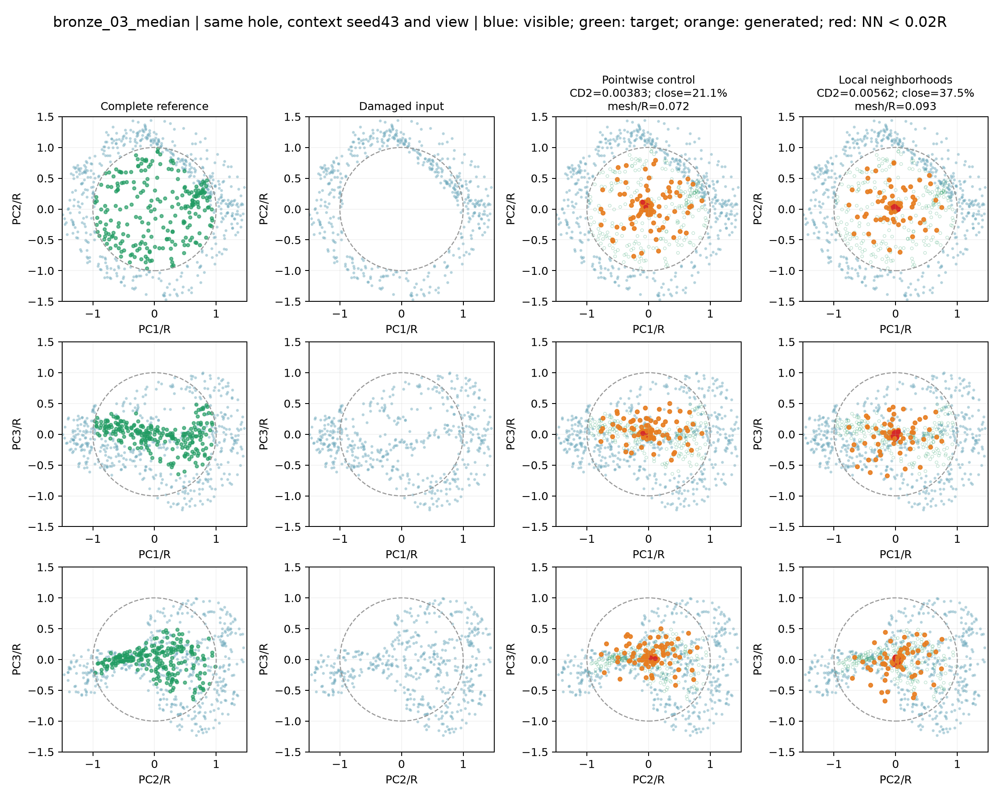
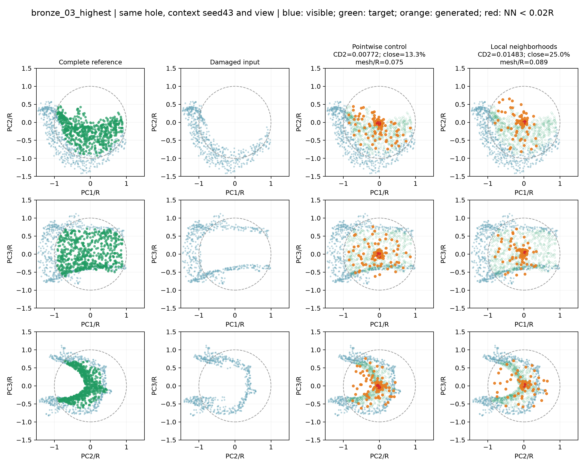
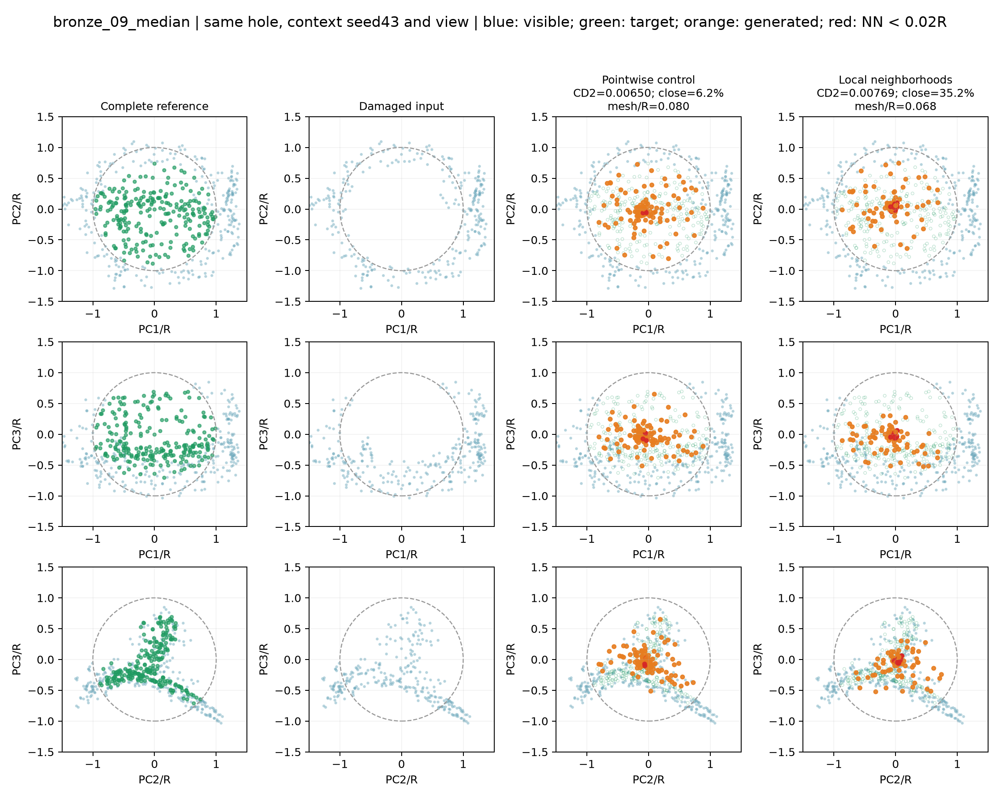
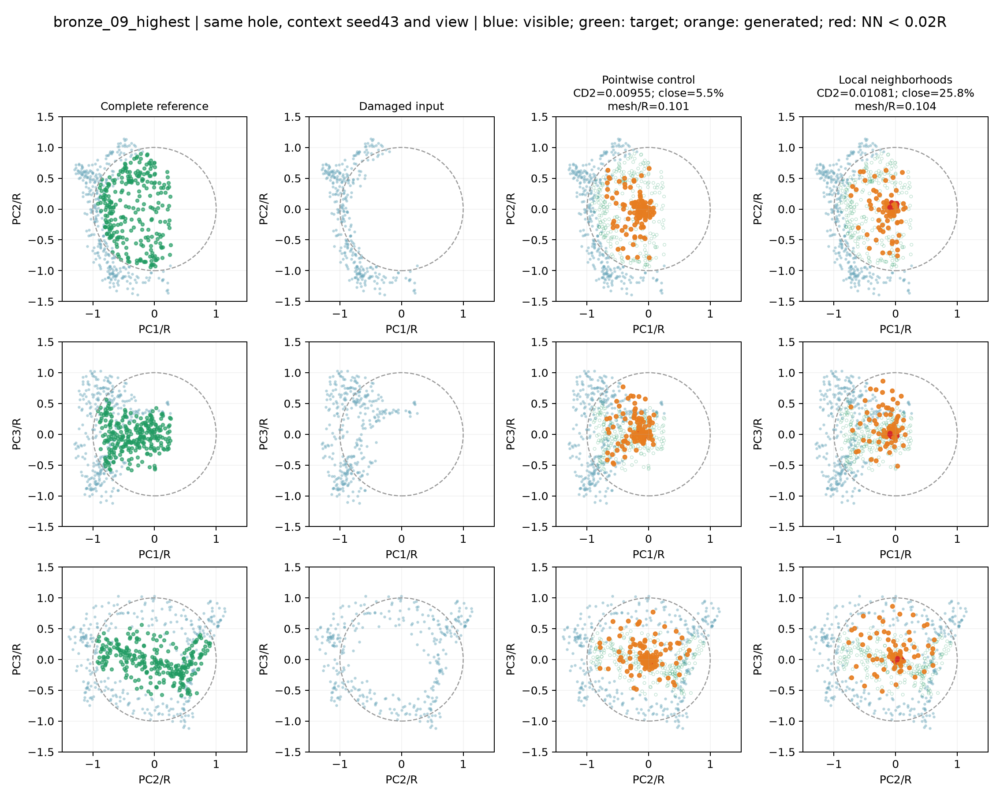

# 同一缺口方案对照

本组为60轮预算内验证best检查点；沿用原20轮宽CD选定的四例，没有依据60轮结果重新挑图，best实际轮次见comparison.json。两个方案参数量相同。

方案：Pointwise control, Local neighborhoods。另附完整局部参考和残缺输入，三个投影视角。所有模型seed42，输入抽样统一seed43、每样本索引；同一案例使用完全相同的512点模型输入。可见展示为完整局部上下文，不等于仅512点模型输入。

## 案例选择与图例

每个验证器物按宽MLP CD²排序，选择第11/20及最高误差，共四例；不能把这些图当作随机代表案例。仅使用验证集。每图统一PCA视角、范围±1.5R和点大小。真实目标仅用于评价和展示，未用于预测。

蓝色为可见点，绿色为缺失目标，橙色为预测；红色为具有距离小于0.02R近邻的预测点，并不直接表示离面。虚线圆为球形缺口半径。三视角用于减少单一投影遮挡。

图注建议：同一验证缺口不同补全方案的三视角局部对照。所有方法使用相同输入采样和显示坐标；绿色参考只用于评价。

## 案例指标

|案例|方案|CD²↓|聚集比例↓|网格距离/R↓|球外缘覆盖↑|
|---|---|---:|---:|---:|---:|
|bronze_03_median|Pointwise control|0.003830|21.1%|0.0716|3.8%|
|bronze_03_median|Local neighborhoods|0.005623|37.5%|0.0933|1.9%|
|bronze_03_highest|Pointwise control|0.007717|13.3%|0.0750|7.5%|
|bronze_03_highest|Local neighborhoods|0.014829|25.0%|0.0890|1.8%|
|bronze_09_median|Pointwise control|0.006497|6.2%|0.0799|0.0%|
|bronze_09_median|Local neighborhoods|0.007688|35.2%|0.0682|4.7%|
|bronze_09_highest|Pointwise control|0.009549|5.5%|0.1013|7.1%|
|bronze_09_highest|Local neighborhoods|0.010809|25.8%|0.1036|4.4%|

### bronze_03_median
样本：`val/model_0003_sample_0005`。报告位置：结果分析—同缺口定性对照。

### bronze_03_highest
样本：`val/model_0003_sample_0015`。报告位置：结果分析—同缺口定性对照。

### bronze_09_median
样本：`val/model_0009_sample_0003`。报告位置：结果分析—同缺口定性对照。

### bronze_09_highest
样本：`val/model_0009_sample_0010`。报告位置：结果分析—同缺口定性对照。

## 如何解读

所选四例中，邻域模型的CD²和聚集比例均高于逐点对照。bronze_09_median中邻域到网格距离更小（0.0682对0.0799），但缺失目标形状仍没有完整恢复；这个单一局部优势不能替代全40缺口的汇总。

先观察三投影中预测是否覆盖绿色目标，再用网格距离检查离面。红点用于定位局部聚集。球外缘覆盖只是人工球形挖洞的覆盖诊断，不能当作真实破损接缝连续性。不能从二维图或到完整网格距离单独断言接缝已修复。

主要容量对照是Pointwise control与Local neighborhoods，二者参数完全相同。各图并非独立器物重复，也不能取代全40缺口及三训练种子的汇总。原始预测、完整参考、PCA矩阵和实际模型输入保存于同目录NPZ，指标和模型哈希见comparison.json。
