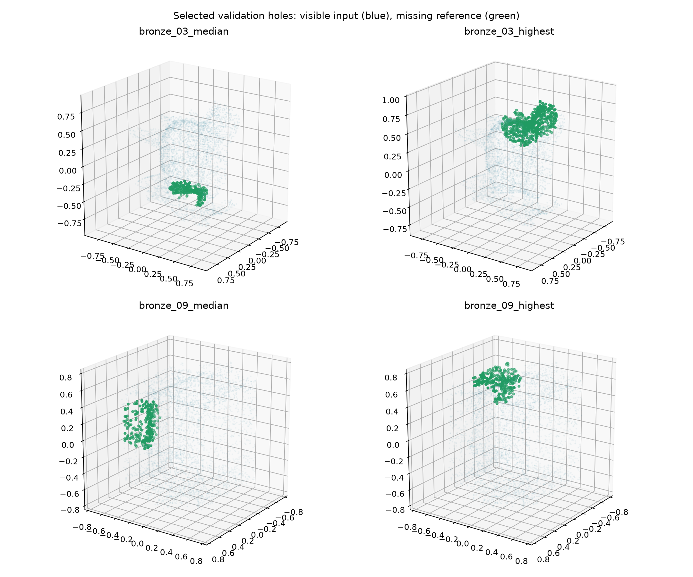
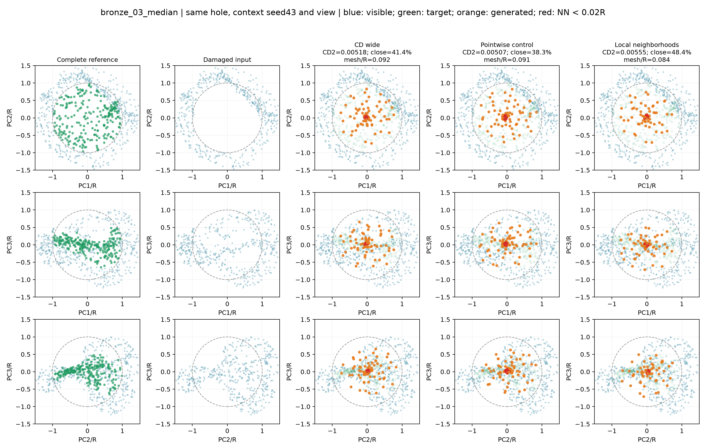
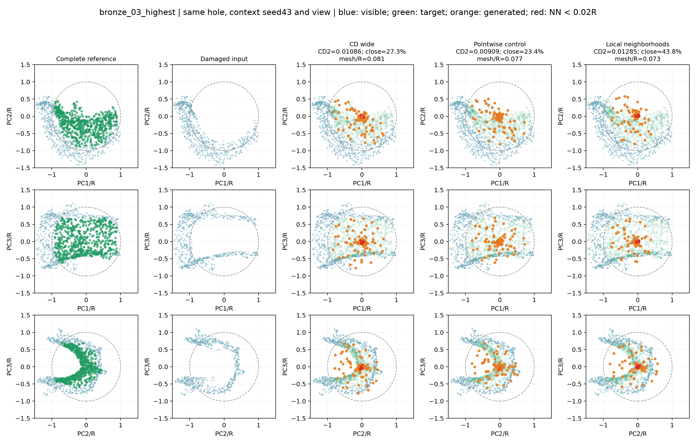
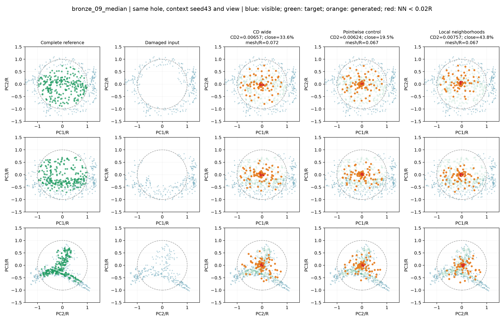
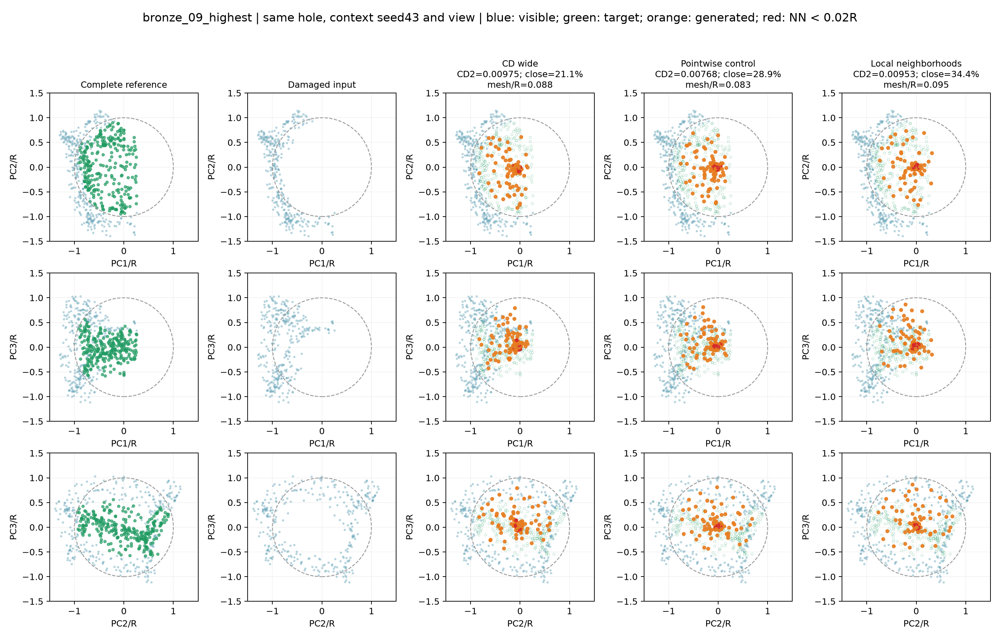

# 同一缺口方案对照

方案：CD wide, Pointwise control, Local neighborhoods。另附完整局部参考和残缺输入，三个投影视角。所有模型seed42，输入抽样统一seed43、每样本索引；同一案例使用完全相同的512点模型输入。可见展示为完整局部上下文，不等于仅512点模型输入。

## 案例选择与图例

每个验证器物按宽MLP CD²排序，选择第11/20及最高误差，共四例；不能把这些图当作随机代表案例。仅使用验证集。每图统一PCA视角、范围±1.5R和点大小。真实目标仅用于评价和展示，未用于预测。

蓝色为可见点，绿色为缺失目标，橙色为预测；红色为具有距离小于0.02R近邻的预测点，并不直接表示离面。虚线圆为球形缺口半径。三视角用于减少单一投影遮挡。

图注建议：同一验证缺口不同补全方案的三视角局部对照。所有方法使用相同输入采样和显示坐标；绿色参考只用于评价。

## 案例指标

|案例|方案|CD²↓|聚集比例↓|网格距离/R↓|球外缘覆盖↑|
|---|---|---:|---:|---:|---:|
|bronze_03_median|CD wide|0.005176|41.4%|0.0917|5.7%|
|bronze_03_median|Pointwise control|0.005068|38.3%|0.0911|0.9%|
|bronze_03_median|Local neighborhoods|0.005554|48.4%|0.0841|2.8%|
|bronze_03_highest|CD wide|0.010858|27.3%|0.0810|8.4%|
|bronze_03_highest|Pointwise control|0.009086|23.4%|0.0767|3.5%|
|bronze_03_highest|Local neighborhoods|0.012847|43.8%|0.0730|4.0%|
|bronze_09_median|CD wide|0.006571|33.6%|0.0718|2.4%|
|bronze_09_median|Pointwise control|0.006236|19.5%|0.0671|0.0%|
|bronze_09_median|Local neighborhoods|0.007569|43.8%|0.0674|1.2%|
|bronze_09_highest|CD wide|0.009747|21.1%|0.0880|8.8%|
|bronze_09_highest|Pointwise control|0.007683|28.9%|0.0833|4.4%|
|bronze_09_highest|Local neighborhoods|0.009526|34.4%|0.0952|6.2%|

### bronze_03_median
样本：`val/model_0003_sample_0005`。报告位置：结果分析—同缺口定性对照。

### bronze_03_highest
样本：`val/model_0003_sample_0015`。报告位置：结果分析—同缺口定性对照。

### bronze_09_median
样本：`val/model_0009_sample_0003`。报告位置：结果分析—同缺口定性对照。

### bronze_09_highest
样本：`val/model_0009_sample_0010`。报告位置：结果分析—同缺口定性对照。

## 如何解读

先观察三投影中预测是否覆盖绿色目标，再用网格距离检查离面。红点用于定位局部聚集。球外缘覆盖只是人工球形挖洞的覆盖诊断，不能当作真实破损接缝连续性。不能从二维图或到完整网格距离单独断言接缝已修复。

主要容量对照是Pointwise control与Local neighborhoods，二者参数完全相同；宽MLP少384参数。各图并非独立器物重复，也不能取代全40缺口及三训练种子的汇总。原始预测、完整参考、PCA矩阵和实际模型输入保存于同目录NPZ，指标和模型哈希见comparison.json。

检查观察：四例local的聚集比例都高于pointwise control，四例CD²也更高。bronze_03_highest中，local网格距离/R反而较小（0.0730对0.0767），但目标覆盖和CD²更差，说明靠近某处表面并不等于补回完整缺失片。两个bronze_09案例的局部形状也未恢复。应结合全40缺口汇总，不由某个局部距离更低的案例宣布成功。
