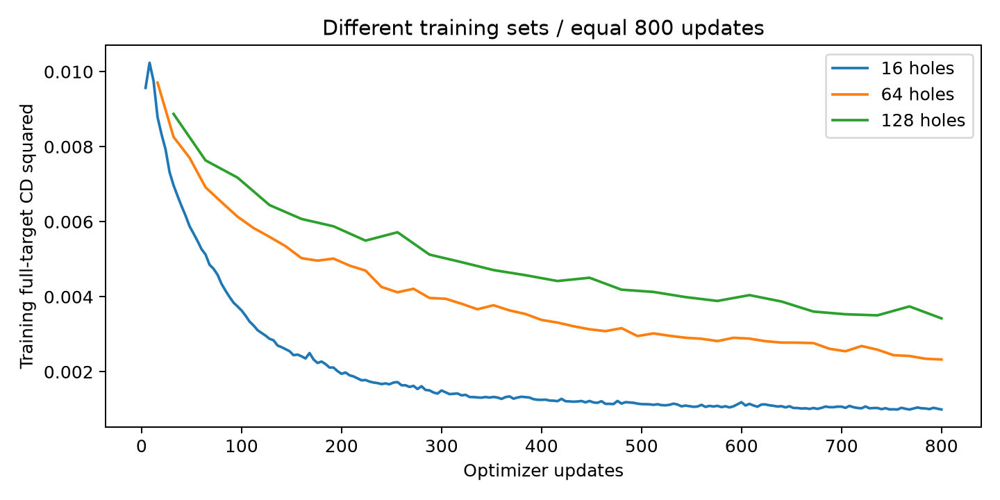
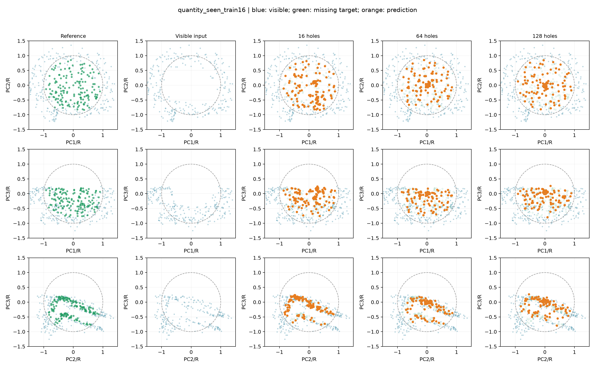
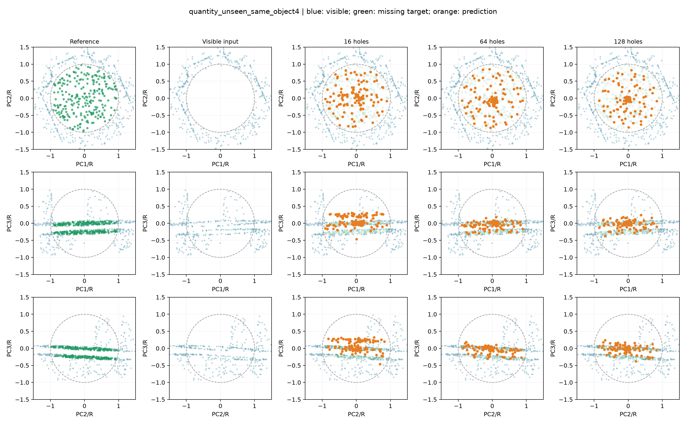
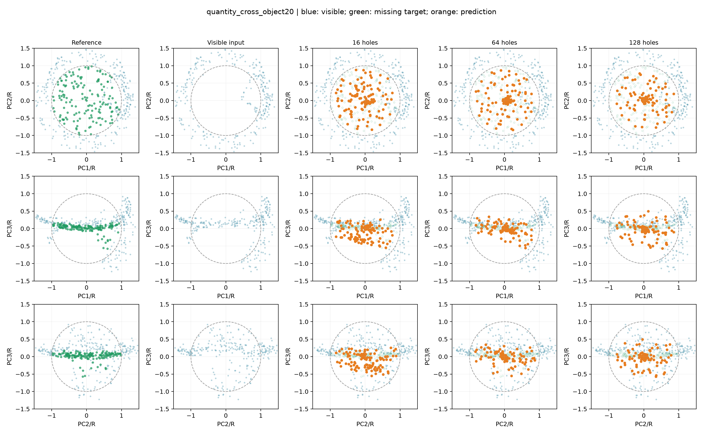

# 固定更新次数的训练缺口数量对照

司母戊鼎16、64、128个训练缺口，batch4，各800次更新，分别200、50、25轮；seed42、Adam lr0.001、逐点XYZ编码、tanh、解码1140、615236参数、512输入/128输出与目标、CD²/R²均相同。取最后权重，未按评价结果挑选轮数。复用16缺口基线并校验哈希。

新增缺口基于相同4096完整点，半径为包围盒对角线0.08–0.18、缺失比例0.02–0.20，生成seed20261013。保留原16份NPZ字节不变，64是128的严格前缀。归一化只用可见点；三个方案均处理3200个训练样本，计算耗时不保证相等。

这是同一器物的损坏覆盖实验，缺失区域允许重叠；4个原评价缺口未直接加入训练，但其表面点可能出现在其他训练目标中。不能视为不重叠区域验证或新增器物实验。评价输入seed43固定，原测试器物06/07未使用。

|评价范围|训练缺口|CD²↓|F-score↑|聚集比例↓|网格距离/R↓|
|---|---:|---:|---:|---:|---:|
|seen_train16|16|0.00099552|0.661902|10.40%|0.017563|
|seen_train16|64|0.00238681|0.331861|20.02%|0.037183|
|seen_train16|128|0.00331477|0.210345|22.22%|0.053407|
|unseen_same_object4|16|0.00588787|0.140230|5.66%|0.085778|
|unseen_same_object4|64|0.00403882|0.163325|19.34%|0.045912|
|unseen_same_object4|128|0.00459257|0.109349|23.63%|0.059514|
|cross_object20|16|0.00831449|0.116481|1.41%|0.147531|
|cross_object20|64|0.00732653|0.125642|18.75%|0.108770|
|cross_object20|128|0.00660021|0.121203|22.42%|0.098869|

聚集比例为预测点最近邻距离小于0.02R的比例；网格距离只用于评价，未用于训练或预测投影。

|训练缺口|全表面点被训练目标覆盖|4个评价目标的覆盖比例|
|---:|---:|---|
|16|59.23%|100.00%, 35.56%, 98.97%, 100.00%|
|64|95.34%|100.00%, 100.00%, 98.97%, 100.00%|
|128|99.85%|100.00%, 100.00%, 98.97%, 100.00%|

## 结果解释

相同器物4个新缺口的CD²相对16缺口基线：64个训练缺口 -31.40%；128个训练缺口 -22.00%。负数代表下降。
64缺口的同器物新位置CD、F-score和表面距离改善，但聚集比例由5.66%升至19.34%；128缺口F-score反而下降。数据覆盖带来部分收益，点聚集与薄壁形状仍未解决，当前不替换冻结原型。下一步将64缺口作为候选做配对种子复验，再决定是否扩展到多器物实验。该候选由本轮探索结果提出，复验仍不能称为全新盲测。
单器物、单种子和仅4个新缺口，结果用于定位数据覆盖问题，不证明跨器物泛化。增加缺口同时减少每个缺口的重复训练，不能将变化归因于数量单一因素。

曲线分别评价各自训练集，不能当作相同训练样本的直接拟合比较。

### seen_train16
样本：`train/model_0002_sample_0000`。相同上下文和展示视角；PCA仅用于绘图。

### unseen_same_object4
样本：`train/model_0002_sample_0016`。相同上下文和展示视角；PCA仅用于绘图。

### cross_object20
样本：`val/model_0003_sample_0000`。相同上下文和展示视角；PCA仅用于绘图。

